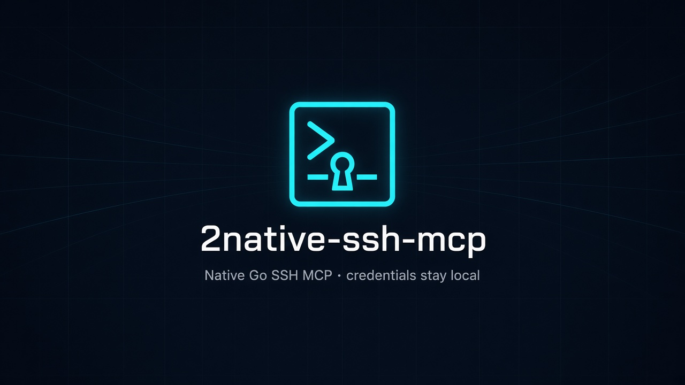
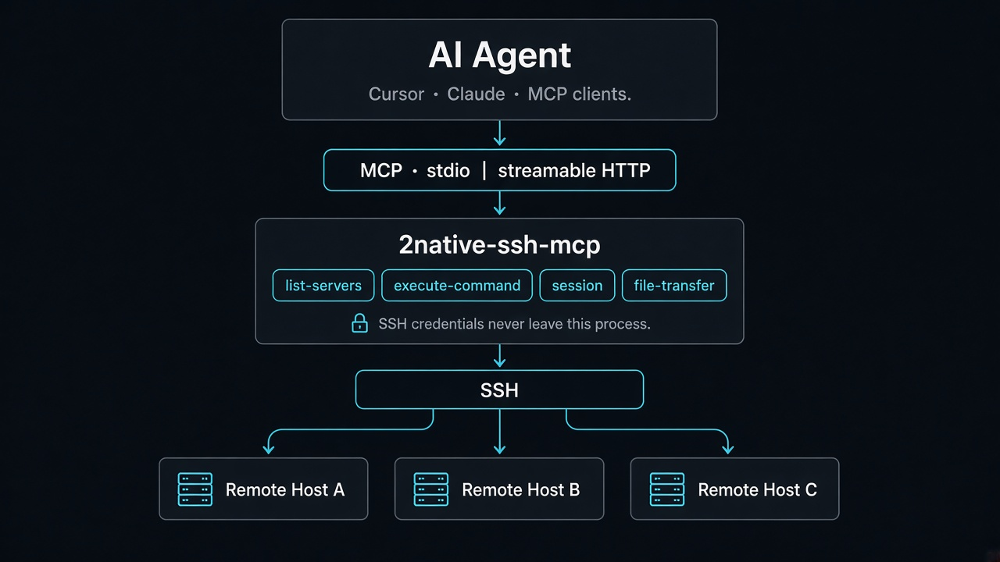
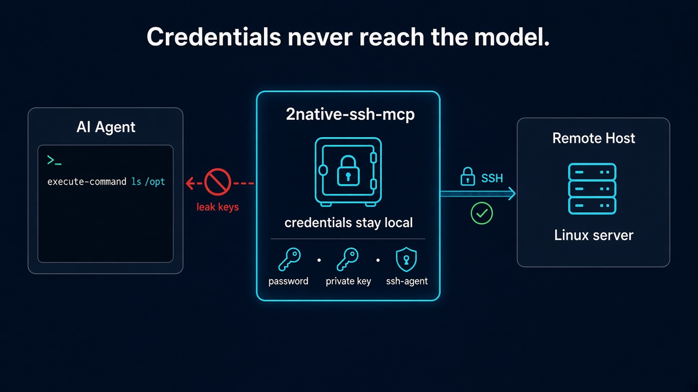

> [中文](README.md)

# 2native-ssh-mcp

[](https://github.com/daidaiJ/2native-ssh-mcp/actions/workflows/ci.yml)
[](https://github.com/daidaiJ/2native-ssh-mcp/releases/latest)
[](go.mod)
[](LICENSE)
[](https://github.com/daidaiJ/2native-ssh-mcp/attestations)
[](https://registry.modelcontextprotocol.io/v0.1/servers?search=2native-ssh-mcp)

<p align="center">
  
</p>

An SSH-based MCP (Model Context Protocol) server in Go. Lets AI assistants run remote commands and transfer files over MCP while SSH credentials stay entirely local, never exposed to the model.

> This project draws on the design of [classfang/ssh-mcp-server](https://github.com/classfang/ssh-mcp-server) (TypeScript), rewritten in Go with file operations consolidated into a **single tool** and **progress notifications**. Thanks to the original author for open-sourcing it.

## Architecture

<p align="center">
  
</p>

The agent only sees four MCP tools. SSH credentials stay in the local process and never enter the model context.

## 📖 Docs

| Reader | Doc | Notes |
|---|---|---|
| 🤖 AI Agent | [docs/AGENT_GUIDE.en.md](docs/AGENT_GUIDE.en.md) | Token-efficient: tool params, config, secure setup, deployment |
| 👤 Human users | [docs/HUMAN_GUIDE.en.md](docs/HUMAN_GUIDE.en.md) | Readable: secure setup, quick start, tool reference, release flow |
| 🔍 Features | [docs/FEATURES.en.md](docs/FEATURES.en.md) | Full feature list and known limitations |
| 🛠 Development | [docs/DEVELOPMENT.en.md](docs/DEVELOPMENT.en.md) | Project structure, build & test, Release and MCP Registry publishing |
| 🔐 Security | [SECURITY.en.md](SECURITY.en.md) | Threat model, approval gate, audit flush policy, tiered hardening |

Docs are Chinese by default; the same-name `.en.md` files are the English versions.

## ✨ Highlights

- **Four tools**: `list-servers` / `execute-command` / `session` / `file-transfer`; background long-running work is a special mode of `execute-command` (`background: true`), not a fifth tool
- **Remote execution**: lazy connection + keepalive, timeouts kill the remote process group by PID, no PTY by default, background jobs survive disconnects and reattach
- **Output handling**: ANSI stripped, large output spilled to local files (`.ssh-mcp-out/`) for the agent to Read/Grep instead of re-running remotely
- **File transfer**: atomic landing, deduplication, resumable transfer, recursive directories, sha256 verification, progress notifications
- **Destructive-command approval (optional)**: `approvalMode: "ask-destructive"` prompts via MCP elicitation; built-in classifier plus user extensions/exemptions — gray areas are yours to decide; fails open when the client cannot prompt
- **Tamper-evident audit log**: every command is appended to a SHA-256 hash chain (JSONL); later tampering is pinpointed to the line (`audit-verify`); flush policy tunable (batched/write-through) → [Audit log](docs/HUMAN_GUIDE.en.md#audit-log-tamper-evident-command-history-hash-chain)
- **Jump-host tunnel**: `via` (OpenSSH ProxyJump) reaches internal hosts through the jump host's `direct-tcpip` channel; each hop authenticates independently, no agent forwarding; exec/shell/SFTP behave as a direct connection → [Jump hosts](docs/HUMAN_GUIDE.en.md#jump-hosts-via-openssh-proxyjump)
- **Security**: command whitelist/blacklist, path whitelisting, credential isolation, config permission checks
- **Dual transport**: stdio / streamable HTTP daemon (refcounting, health check, one-click Windows autostart)
- **Auth & compatibility**: password/private key/ssh-agent/Pageant/keyboard-interactive 2FA (the challenge pops up in the MCP client; unattended setups fall back to an env var), proxies, algorithm negotiation (legacy servers) → [Authentication](docs/HUMAN_GUIDE.en.md#authentication-methods)

<p align="center">
  
</p>

Full feature list: [docs/FEATURES.en.md](docs/FEATURES.en.md).

## 🚀 Quick Start

```bash
# Build
go build -o 2native-ssh-mcp.exe .

# stdio mode (launched by MCP client, credentials in config.json or environment variables)
2native-ssh-mcp.exe --config-file config.json

# HTTP persistent daemon
2native-ssh-mcp.exe start --config-file config.json --http-addr 127.0.0.1:8338
```

See the two guides above for detailed configuration and deployment steps.

## License

ISC License (same as upstream, upstream copyright notice preserved, see [LICENSE](LICENSE))
